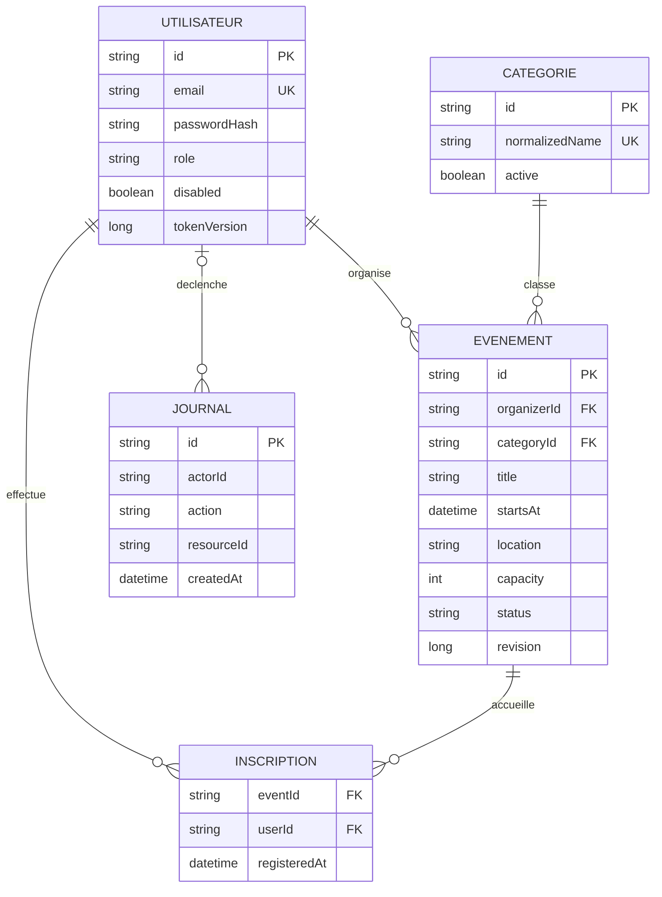
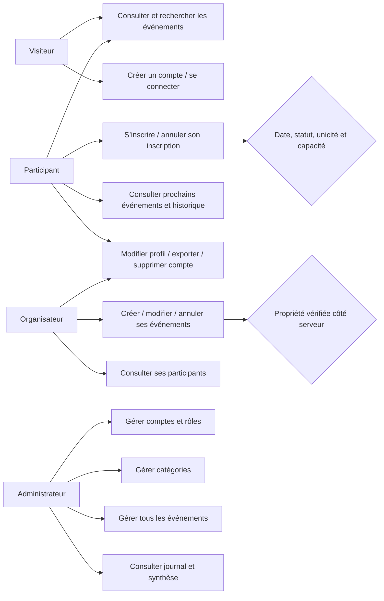
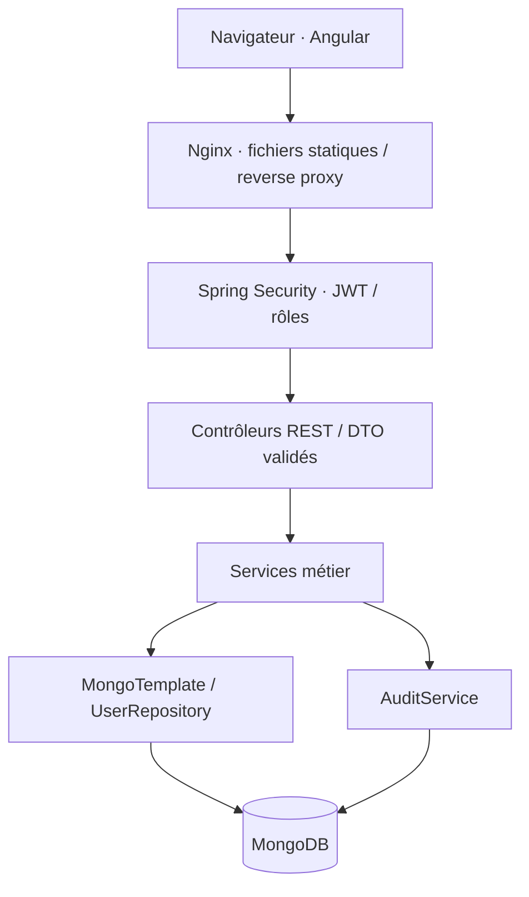
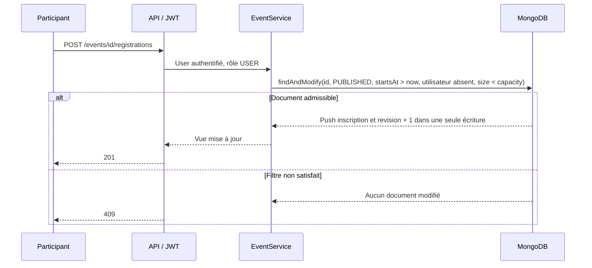

# Conception

## Modèle conceptuel de données (indépendant du stockage)

## Passage au modèle documentaire

`events.registrations` est un tableau de `{ userId, registeredAt }`. Le couple conceptuel
événement/participant est unique grâce au filtre de mise à jour, pas à un index unique
multikey (qui ne garantirait pas l’unicité dans un même document). Les coordonnées du
participant ne sont pas recopiées dans les événements. L’API publique retourne une vue
sans le tableau ni les identifiants des participants.

Indexes : `users.email` unique, `categories.normalizedName` unique, date et organisateur
des événements, TTL sur `audit.createdAt` (90 jours). Les utilisateurs historiques doivent
être normalisés avant création de l’index e-mail ; résoudre les collisions explicitement,
sans suppression automatique de comptes. Un index unique simple n’est pas insensible
à la casse ; c’est la normalisation à chaque écriture qui l’assure.

La suppression d’une catégorie est remplacée par une désactivation pour conserver les
références. L’effacement d’un utilisateur retire ses inscriptions et ses données personnelles ;
les événements restent avec un identifiant organisateur non résolu et sans coordonnées.

## Cas d’utilisation

## Architecture

Contrôleurs : adaptation HTTP et validation. Services : règles métier et autorisations.
Modèles : documents persistants. DTO/vues : exposition contrôlée. Angular ne décide
jamais des permissions réelles : les gardes servent uniquement à l’ergonomie.

## Inscription atomique

L’annulation, la réservation et l’édition portent sur le même document. L’édition compare
la révision ; les réservations incrémentent cette révision. Pas de lecture puis écriture
non protégée pour le dernier siège. Aucun verrou Java en mémoire : la garantie fonctionne
sur plusieurs instances d’API. Les tests lancent des requêtes HTTP concurrentes réelles.

Les opérations d’effacement d’un compte touchent plusieurs documents et sont des
opérations de maintenance réessayables, pas une transaction globale. Pour une exploitation
à fort trafic, prévoir une désactivation préalable et une file de purge contrôlée pour
traiter les requêtes déjà en vol, ainsi qu’un rapprochement des références orphelines.
