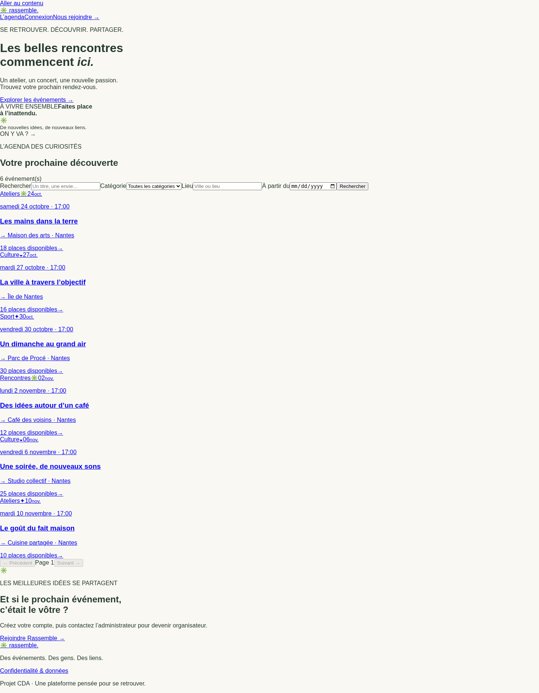
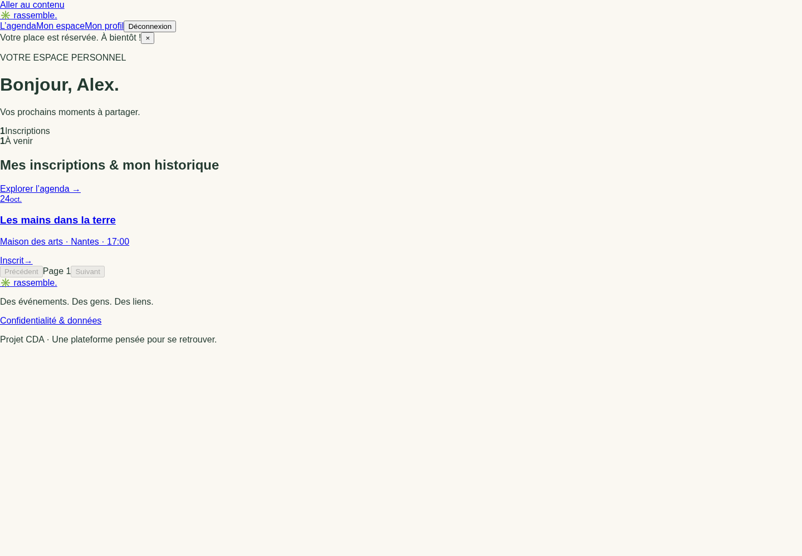
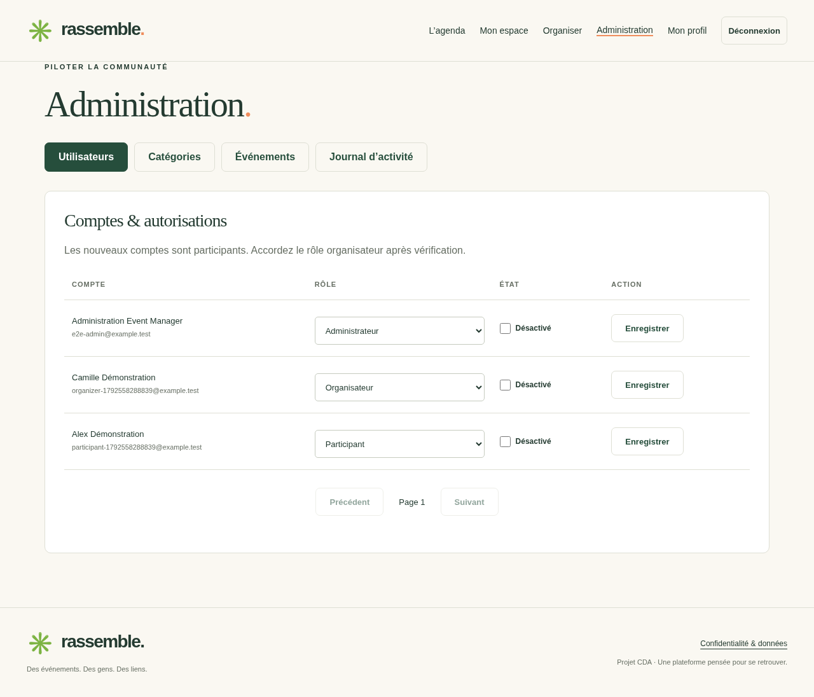

# Preuves et traçabilité

Ce fichier recense uniquement les vérifications effectivement exécutées dans l’environnement
courant. Les résultats finaux figurent dans le tableau ajouté après validation.

Sources des preuves : code et diff Git, rapports JUnit, rapport Playwright, captures de
parcours avec données fictives, builds, configuration de déploiement. Les artefacts
volumineux sont ignorés par Git ; les joindre à la remise si nécessaire. Aucun historique
de commits, ticket externe, réunion ou retour client n’a été fabriqué.

Ne jamais joindre `.env`, les variables de processus, les mots de passe, les jetons ou les
logs complets non relus. Les captures test utilisent exclusivement des comptes fictifs.

## Collecte proposée

| Preuve | Emplacement | Interprétation |
|---|---|---|
| Résultats JUnit | backend/build/test-results/test/*.xml | tests terminés et nombre exact |
| Rapport lisible | backend/build/reports/tests/test | détail des scénarios API |
| Rapport navigateur | frontend/playwright-report | parcours frontend/API réels |
| Captures | artifacts/screenshots | interface avec données de démonstration |
| Tests et règles | docs/TESTS.md | correspondance exigences/vérifications |
| Configuration CI | .github/workflows/ci.yml | pipeline livré ; exécution distante non attestée |
| Source présentée | git status / git diff / git rev-parse HEAD | identité réelle du code, pas d’historique inventé |

## Validation finale — 21 octobre 2026

| Vérification exécutée | Résultat observé |
|---|---|
| JUnit / API réelle / MongoDB | **14 tests passés, 0 échec, 0 ignoré** |
| Playwright / Chromium | **4 parcours passés, 0 échec, 0 ignoré** |
| Build backend et JAR | réussi |
| Build Angular de production | réussi ; bundle initial environ 404 ko |
| Formatage Java / Prettier / diff Git | vérifications passées |
| Audit npm, dépendances de production | 0 vulnérabilité connue au moment du contrôle |
| Images Docker backend et frontend | construites avec TLS vérifié et secrets BuildKit temporaires |
| Application Docker / MongoDB authentifié | parcours connexion, réservation, tableau de bord et déconnexion validé |
| Démarrage natif scripts/dev.sh | proxy Angular, readiness et parcours compte validés ; processus de test arrêtés |
| Jeu fictif scripts/seed-demo.mjs | exécuté puis réexécuté sans doubler les six événements |
| Diagrammes Mermaid | 5 diagrammes interprétés et exportés en SVG |
| CI GitHub distante | échec de démarrage MongoDB signalé par l’utilisateur ; correction du démarrage testée localement, nouvelle exécution distante à vérifier |
| Publication cloud / mise en production | non effectuée |

Le site OWASP a refusé l’accès direct (403) ; la liste 2025 a été vérifiée à partir du
dépôt GitHub officiel OWASP. Les téléchargements Playwright étant interdits sur ce
réseau, les tests ont utilisé Chromium système, sans désactivation de vérification TLS.
Un défaut de permissions de configuration Nginx a été corrigé puis le conteneur retesté.

Résultats détaillés : [verification.json](evidence/verification.json), [manifeste des
sources](evidence/source-manifest.sha256) et rapports JUnit anonymisés dans
[evidence/junit](evidence/junit). Le manifeste identifie les sources vérifiées, sans
prétendre que les changements ont été commités ou poussés.

### Captures réellement produites (données fictives)

- [Agenda desktop — six événements](evidence/screenshots/08-container-home.png).
- [Agenda mobile](evidence/screenshots/09-container-mobile.png).
- [Tableau de bord participant](evidence/screenshots/10-container-dashboard.png).
- [Détail d’événement](evidence/screenshots/02-event-detail.png).
- [Espace organisateur](evidence/screenshots/05-organizer-event.png).
- [Administration](evidence/screenshots/06-administration.png).
- [Journal d’activité](evidence/screenshots/07-audit.png).

Ces preuves témoignent de la livraison technique dans cet environnement ; elles ne
remplacent pas l’acceptation pédagogique, l’analyse personnelle, l’audit de production
ou les tests humains d’accessibilité. Les configurations privées restent hors du dépôt.

### Aperçus intégrés

### Suivi du démarrage CI

L’utilisateur a signalé un échec d’initialisation du service MongoDB avant exécution
des tests GitHub. L’image et l’ancien health check ont démarré correctement en local ;
la cause distante exacte n’est donc pas établie sans les logs du conteneur.
Le workflow utilise désormais `scripts/ci-mongo.sh` après checkout : attente de
readiness explicite (120 s maximum), erreur si le processus quitte, conservation
des logs dans les artefacts des deux jobs et nettoyage en fin de job. Le script
et une connexion MongoDB depuis l’hôte ont été validés sur un conteneur isolé local.
Ce changement ne transforme pas une panne de base en test réussi ; une nouvelle
exécution GitHub reste nécessaire pour confirmer le résultat distant.

### Cause confirmée de la panne CI

Les logs fournis par l’utilisateur identifient la cause : l’image MongoDB 8.0
(digest `4a4ab5d4834207389e0d7270fac988e21ffedccecba77991a552f755df229907`)
refuse de démarrer sur un noyau Linux 6.19 ou ultérieur (MongoDB SERVER-121912).
Le label `ubuntu-latest` migrait vers Ubuntu 26. Les deux jobs sont désormais
fixés sur `ubuntu-24.04` ; le manifeste officiel runner-images consulté indique
un noyau 6.17.0-1022-azure pour cette image. Les actions checkout, setup-java,
setup-node, upload-artifact et setup-gradle utilisent des versions avec runtime
Node 24 vérifié dans leurs manifestes officiels.
Le résultat de la nouvelle exécution GitHub reste à confirmer ; aucune exécution
distante réussie n’est affirmée depuis cet environnement.

### Révision après échec du job frontend

Une capture ultérieure montre le backend réussi et le job frontend refusé par MongoDB
pour le même noyau >= 6.19. L’horodatage est compatible avec le run du commit 808c2fa ;
le passage à Ubuntu 24.04 n’est donc pas considéré comme une correction distante validée.
Les deux jobs sont désormais fixés sur Ubuntu 22.04 ; le manifeste officiel runner-images
consulté indique 6.8.0-1064-azure. Le helper affiche `uname -sr` pour identifier le noyau
effectif. L’application et les tests ne sont pas modifiés ni désactivés. Le nouveau
résultat distant reste à confirmer.
