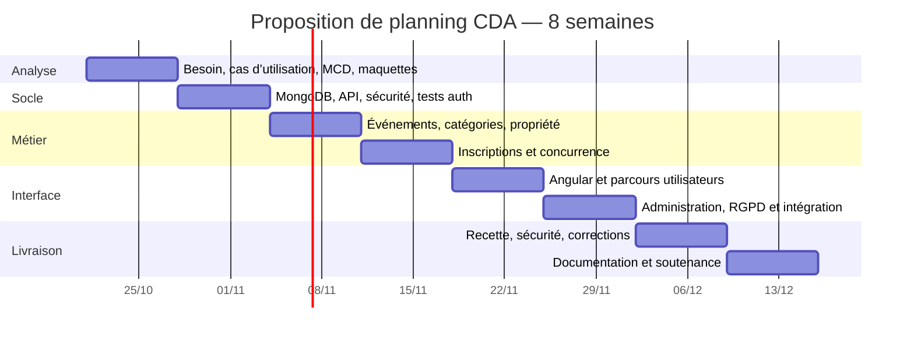

# Gestion de projet

## Méthode

Backlog priorisé par valeur métier et risques ; itérations courtes avec une démonstration
fonctionnelle et des critères de validation. Ce document formalise une organisation
possible ; il ne prétend pas qu’une équipe Scrum, un client ou des réunions historiques
ont existé. Utiliser des branches de travail et des PR pour les évolutions futures ; aucun
push ou ticket externe n’est effectué automatiquement.

## Gantt prévisionnel (8 semaines)

Les dates sont un scénario proposé à partir du 21 octobre 2026, à adapter au calendrier
réel de formation. Ce Gantt n’est pas une feuille de temps de travail réalisé.

## Backlog livré à recetter

| Ticket | Priorité | Critère d’acceptation | Preuve technique |
|---|---|---|---|
| AUTH-01 Comptes/JWT | P0 | inscription, login et révocation | tests auth HTTP |
| AUTH-02 Rôles | P0 | jamais de rôle choisi à l’inscription | tests privilèges |
| EVT-01 Agenda | P0 | filtres et pagination bornés | tests recherche + navigateur |
| EVT-02 Gestion | P0 | propriétaire ou admin seulement | tests propriété |
| REG-01 Places | P0 | aucune surcapacité simultanée | 12 requêtes / 3 places |
| REG-02 Unicité | P0 | un utilisateur inscrit une fois | 6 requêtes simultanées |
| ADM-01 Administration | P0 | gestion comptes, catégories, événements | API + écran admin |
| UI-01 Interface française | P0 | parcours complet, responsive | Playwright / captures |
| DATA-01 Données personnelles | P0 | export, correction, suppression | test effacement |
| OPS-01 Livraison | P0 | build et lancement documentés | Docker / CI |
| DOC-01 Dossier CDA | P0 | schémas, tests, sécurité, bilan | dossier docs |

Statut : implémenté dans la livraison ; l’acceptation par l’utilisateur et l’enseignant
reste distincte. Les résultats de commandes sont recensés dans EVIDENCE.md.

## Risques

| Risque | Réponse |
|---|---|
| Périmètre trop vaste | MVP limité, extensions hors engagement |
| Surcapacité ou doublons | Mise à jour MongoDB atomique, tests concurrents |
| Escalade de privilèges | rôle initial fixe, contrôles serveur, réauthentification après changement |
| Écart SQL / critères de certification | faire valider MongoDB seul par l’enseignant |
| Fuite de données dans le dossier | comptes fictifs, pas de secrets ni adresses réelles dans les preuves |
| Perte de données | volume, sauvegardes, test de restauration |
| Documentation prise pour une expérience réelle | éléments personnels et validations marqués à compléter |
